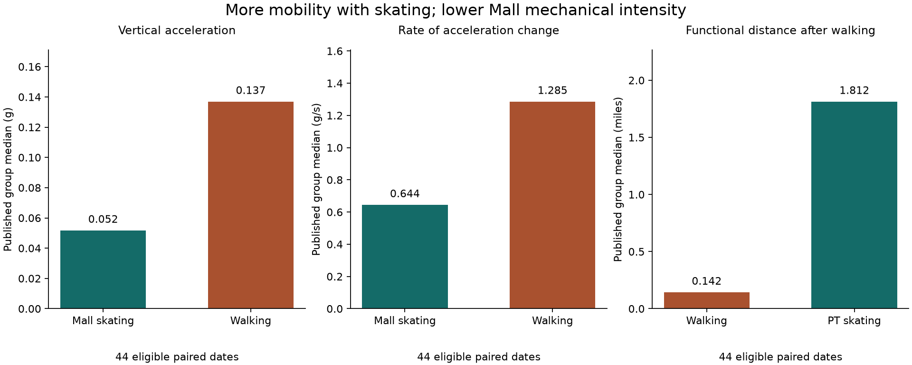

# HandicapSkater evidence notebooks

This is a continuing N-of-1 research program: the original Public notebook
established the longitudinal WHOOP/Strava analysis and hypotheses; those
informed the legal notebook design, which already incorporated targeted
Kubios/Polar H10 evidence; the current work refines the combined longitudinal
and episodic approach with more specific metrics and validation.

Read the [research evolution and hypothesis crosswalk](docs/research_evolution.md)
for that scientific progression and its connection to the preserved legal
record. Current results use a small public aggregate excerpt through 2026-09-03.

| Notebook | Read it for |
| --- | --- |
| [Public](HandicapSkater-Public.ipynb) | Technical project overview: Data Engineering, Statistics, Deep Learning, Model Evaluation, XGBoost/SHAP, current mobility evidence, and referenced conclusions |
| [Scientific](HandicapSkater-Scientific.ipynb) | Hypothesis-to-metric continuity, methods, source/time-scale provenance, inference grain and FSI/CSS readiness |
| [Scientific Succinct](HandicapSkater-ScientificSuccinct.ipynb) | A compact reviewer summary |

The central finding combines repeated walking distance loss, greater distance
with PT skating, and higher walking vertical acceleration/jerk than Mall
skating. Results support an individualized functional-accommodation argument.
They do not directly measure pain or establish medical/legal necessity alone.



## Run locally

The narrative, tables and figure are readable without execution. To run the
aggregate-only presentation cells:

```sh
python3 -m venv .venv
.venv/bin/python -m pip install -r requirements-public.txt
make public-notebook-check PYTHON=.venv/bin/python
.venv/bin/jupyter notebook
```

Launch Jupyter from the repository root. If the Notebook interface is not
installed, open these files in your existing Jupyter-compatible editor and
select this virtual environment's Python kernel. The notebook cells require
the accompanying `scripts/` and `data/public/` directories.

See the [public notebook guide](docs/public_notebooks.md) for source/hash
verification, local rendering, historical preservation and disclosure limits.
See the [FSI/CSS integration design](docs/fsi_css_notebook_integration.md) for
the input mapping and proposed Observatory adoption path.

## Evidence boundaries

> N-of-1 evidence model. Wearable signals estimate physiologic, MSK,
> movement, and transport burden; source artifacts and validation layers remain
> available for audit.

The new excerpt contains six primary aggregate findings and supporting
summaries, with no session rows, raw telemetry, routes, or medical/legal files.
This does not certify unrelated historical files or Git history as public-safe.
WHOOP overnight recovery HRV and Kubios/Polar H10 episodic HRV remain distinct.
FSI/CSS formulas and the Evidence Observatory are unchanged.

## Legal and historical notebooks

Read [notebook roles](docs/notebook_roles.md) before editing or citing
historical material. The frozen filed notebook and living legal research
notebook are described in [the legal README](legal/README.md).

Every file under `legal/` was preserved during this public update. Existing
raw-notebook-lock and reproduction discrepancies remain documented in the
workspace audit; preservation does not mean those pre-existing checks pass.
Do not run legal reproduction or hash-update commands as part of public
notebook maintenance. The original expected legal hashes were not changed.

Earlier root notebook bytes are preserved in Git history and ignored local
backups. Their longitudinal observations and hypothesis-generation contribution
remain foundational; corrections qualify specific analyses rather than erase
that history. Later findings do not rewrite the filed snapshot or automatically
revalidate its numerical claims. The pre-existing Public PDF is a legacy
artifact and was not refreshed.
